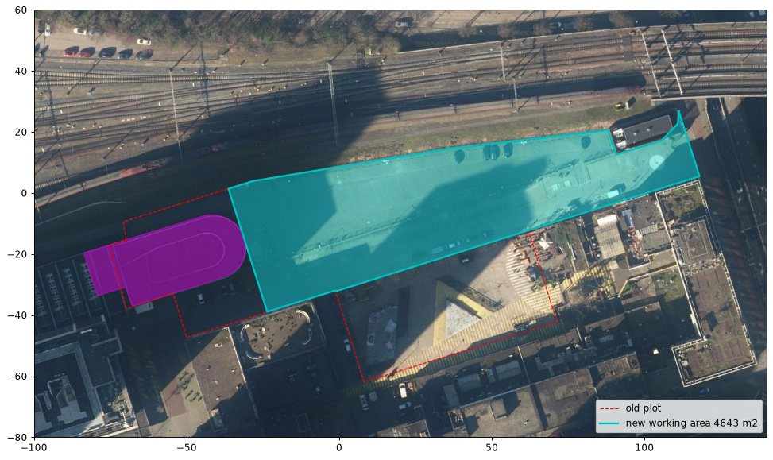

# Building Generation: voxels on the site

A procedural Houdini model of the building site at Schiestraat 11, Rotterdam, next to the Schieblock and the train tracks to Rotterdam Centraal.
It loads the real ground and the real buildings around the site, and fills the area we can build on with a grid of 3 × 3 × 3 m voxels.
This is the base for the next steps (placing the functions, terraces, greenery, parking), which are not in this version.

Nothing is placed by hand. Change an input (the outline of the working area, the voxel size, the height, the angle) and the whole model is generated again.



---

## Contents

1. [Quick start](#quick-start)
2. [Files](#files)
3. [Coordinates](#coordinates)
4. [How the model works](#how-the-model-works)
   - [SITE: the ground](#site-the-ground)
   - [SURROUNDINGS: the buildings around the site](#surroundings-the-buildings-around-the-site)
   - [VOXELS: the building volume](#voxels-the-building-volume)
5. [Changing the model](#changing-the-model)
6. [Where the data comes from](#where-the-data-comes-from)
7. [Known limits](#known-limits)

---

## Quick start

1. Install Houdini (made with Houdini 22.0, the free Apprentice version works and opens `.hipnc` files).
2. Clone this repo, or download it as a ZIP.
3. Open `voxels_on_site.hipnc` in Houdini.
4. In the viewport you see:
   - the green ground (SITE),
   - the grey buildings around the site (SURROUNDINGS),
   - the voxels coloured from blue (ground floor) to red (top floor), with the working area outline in red (VOXELS).
5. The first time, loading takes a few seconds: Houdini reads the 27 MB height map and turns it into 160,000 polygons.

All file paths in the Houdini file start with `$HIP` (= the folder the `.hipnc` file is in). Keep the `data` folder next to the `.hipnc` file and it works on any computer.

---

## Files

```
voxels_on_site.hipnc              the Houdini file
data/
  schieblock.TIF                  height map of the ground (AHN, 0.5 m pixels), given by the course
  surroundings_3dbag.obj          3D BAG buildings within 400 m of the site, made from the files below
  3dbag/
    page_000.json ... page_011.json   3D BAG data (CityJSON) as downloaded from the 3D BAG API
    convert_3dbag_to_obj.py          script that turns these pages into surroundings_3dbag.obj
docs/
  working_area.png                the working area on the aerial photo
  site_sync_check.png             check that the height map lines up with the 3D BAG buildings
```

---

## Coordinates

Everything in the model uses one local coordinate system:

| | |
|---|---|
| Origin (0, 0, 0) | Schiestraat 11, Rotterdam = RD New (EPSG:28992) **x 92247.5, y 437869.7** |
| Houdini X | east (metres) |
| Houdini Z | **south** (metres), so north is −Z |
| Houdini Y | up, in metres **NAP** (Dutch sea level). The ground on the site is about NAP −0.2 m |

The 3D BAG buildings and the height map are both moved into this system, so they line up with each other and with the voxels.
To go from Houdini to RD: `RD x = 92247.5 + X`, `RD y = 437869.7 − Z`.

---

## How the model works

The file has three objects at `/obj`. Each one ends in an `OUT_...` null node with the display flag on.

```
/obj/SITE           ground (height map)               -> OUT_SITE
/obj/SURROUNDINGS   buildings around the site (3D BAG) -> OUT_SURROUNDINGS
/obj/VOXELS         working area + voxels              -> OUT_VOXELS
```

### SITE: the ground

```
load_site_tif -> crop_to_surroundings -> fill_building_holes -> make_lighter_2m -> to_polygons -> ground_green -> OUT_SITE
```

**`load_site_tif`** (Heightfield File) loads `data/schieblock.TIF`.
The TIF is an AHN height map of about 1.9 × 1.9 km around the site, with 0.5 m pixels. It has **no location data** inside it, so Houdini does not know where it belongs. With the default settings Houdini squeezes it into a 1000 m square around the origin, which puts it in the wrong place and at the wrong scale. The node therefore places it by hand:

| Parameter | Value | Why |
|---|---|---|
| Size Method | Grid Spacing | use the real pixel size instead of "fit into 1000 m" |
| Grid Spacing | 0.5 | the TIF has 0.5 m pixels |
| Center | 292.5, 52.5 | the middle of the image is 292.5 m east and 52.5 m south of the origin |
| Rotate | 90 | Houdini reads the image turned by 90°, this turns it back so north is north |
| Clamp Min | off | keep heights below 0 (the ground is around NAP 0, some parts are below) |

These numbers were found by matching the image with the 3D BAG buildings. In the TIF, buildings are holes (no value). These holes were compared with the 3D BAG building footprints at different scales and positions; the best match is at 0.5 m per pixel with the centre above, and then 97 % of test points have the same height in Houdini as in the TIF. `docs/site_sync_check.png` shows the result: the white holes sit exactly on the black 3D BAG outlines.

**`crop_to_surroundings`** (Heightfield Crop) keeps only 800 × 800 m around the origin, the same area as the 3D BAG buildings. This makes the model much lighter.

**`fill_building_holes`** (Python) fills the holes. In the TIF every building is a hole with the value `inf`. The real buildings come from 3D BAG, so here the holes simply become ground: they get the median ground height (about NAP 0). The code reads all heights into a NumPy array, finds the `inf` values and replaces them.

**`make_lighter_2m`** (Heightfield Resample, 0.25) goes from 0.5 m to 2 m cells. Enough detail for the ground, and 16 times fewer polygons.

**`to_polygons`** (Convert HeightField) turns the height field into polygons (400 × 400 cells = 160,000 polygons), and **`ground_green`** colours them green.

### SURROUNDINGS: the buildings around the site

```
load_3dbag_buildings -> light_grey -> buildings_and_ground -> OUT_SURROUNDINGS
```

**`load_3dbag_buildings`** (File) loads `data/surroundings_3dbag.obj`: all 3D BAG buildings within about 400 m, at LoD 2.2 (with roof shapes), already in the local coordinates above. **`light_grey`** colours them grey.

How the OBJ is made (`data/3dbag/convert_3dbag_to_obj.py`, run with `python3 convert_3dbag_to_obj.py` in that folder):

1. It reads every `page_*.json` (CityJSON pages from the 3D BAG API).
2. CityJSON stores vertices as whole numbers plus a `scale` and `translate`; the script turns them back into RD coordinates.
3. For every building it takes the LoD 2.2 geometry and writes each surface (outer ring only) as one OBJ face.
4. While writing, it moves each point to the local system: `X = x − 92247.5`, `Y = height (NAP)`, `Z = −(y − 437869.7)`.

### VOXELS: the building volume

```
working_area ──> make_voxel_grid ──> inside_plot ──> keep_inside_plot ──> cube_on_every_point ──> voxels_and_plot ──> OUT_VOXELS
     │                                   ▲                                       ▲                      ▲
     └──> plot_volume ───────────────────┘                    one_voxel_cube ────┘                      │
     └──> plot_red ─────────────────────────────────────────────────────────────────────────────────────┘
```

**1. `working_area`** (Curve) is the outline of the area we build on, as a closed curve on the ground (Y = 0). It is everything that is not already taken:

- **west**: east of the raised oval car ramp,
- **north**: the train lines,
- **south**: north of the big parking block,
- **east**: up to the Biergarten (which has to stay, see the brief).

It started from the cadastral parcels of the open plot (Kadaster, about 8,265 m², without the Biergarten). It was then cut along the car ramp and the parking block, which were taken from the Dutch large-scale topography map (BGT). The result is about **4,640 m²**. The corners (east, north in metres from the origin) are:

```
(-28.4, 3.9) (36.1, 14.6) (88.0, 20.6) (90.8, 12.6) (105.6, 17.2) (110.9, 22.7)
(111.2, 26.9) (118.0, 5.5) (-1.3, -31.9) (-23.6, -38.9) (-36.3, 1.4)
```

**2. `make_voxel_grid`** (Python) makes one **point** for the centre of every voxel. Its inputs are at the top of the code:

```python
VOXEL_SIZE = 3.0    # metres; one voxel = one 3x3x3 m block (3 m ~ one storey)
HEIGHT = 60.0       # max building height (m) -> 20 floors
ANGLE = 17.5        # degrees; turn of the grid so it follows the streets south of the site
```

What the code does, step by step:

1. It reads the corner points of the working area (the curve is wired into its input).
2. It makes two directions for a grid that is turned by `ANGLE`: `along` (roughly east) and `across` (roughly south). The streets south of the site run at about 17.5°, so the voxels line up with them instead of with north.
3. It measures how far the working area reaches in each of these two directions, and from that how many voxels are needed (`count_u` × `count_w`) to cover all of it. The number of floors is `HEIGHT / VOXEL_SIZE` = 20.
4. Three loops (floor, column, row) make one point per voxel. The `+ 0.5` puts the point in the centre of the voxel, so floor 0 sits on the ground (its centre is at Y = 1.5 m).
5. Every point gets:
   - `floor`: the floor number (0 = ground floor),
   - `orient`: a rotation (quaternion) of `ANGLE` around the Y axis, so the cube placed on it is turned with the grid,
   - `Cd`: a colour from blue (ground floor) to red (top floor), so floors are easy to see.
6. It stores `voxel_size` on the geometry (Detail attribute), so other nodes can read it.

The grid covers the rectangle around the working area, so there are more voxels than needed. The next nodes remove the ones outside.

**3. `plot_volume`** (PolyExtrude) pushes the working area outline 100 m up and closes it at the bottom. The result is a tall closed solid in the shape of the working area. 100 m is just "higher than any building", so it works as a cutter.

**4. `inside_plot`** (Group Create) puts every voxel point that lies **inside** `plot_volume` in the group `inside_plot` (Bounding Type: Bounding Object, with `plot_volume` on its second input). A voxel counts as inside when its centre is inside.

**5. `keep_inside_plot`** (Blast) deletes every point that is **not** in `inside_plot` (Delete Non Selected). What is left are only the voxels in the working area: **10,100 voxels** (505 per floor × 20 floors).

**6. `one_voxel_cube`** (Box) is one cube. Its size is not typed in: it reads `voxel_size` from `make_voxel_grid` with the expression `detail("../make_voxel_grid", "voxel_size", 0)`, so the cubes always have the same size as the voxels and touch each other.

**7. `cube_on_every_point`** (Copy to Points) puts one cube on every voxel point. It uses the `orient` attribute to turn each cube with the grid, and copies `Cd` and `floor` from the points onto the cubes.

**8. `plot_red`** colours the working area outline red, and **`voxels_and_plot`** (Merge) puts the cubes and the outline together. **`OUT_VOXELS`** is the end of the chain.

---

## Changing the model

Everything below updates the whole model automatically.

| What | Where | How |
|---|---|---|
| The area we build on | `VOXELS/working_area` | Select the node, press Enter in the viewport and drag the points, or type new coordinates in the *Coordinates* parameter (`x,0,z` per point; z = minus north). |
| Voxel size | `VOXELS/make_voxel_grid` → `VOXEL_SIZE` | e.g. 1.5 for half-size voxels (8 × more voxels). The cubes follow automatically. |
| Building height | `VOXELS/make_voxel_grid` → `HEIGHT` | number of floors = `HEIGHT / VOXEL_SIZE` |
| Direction of the grid | `VOXELS/make_voxel_grid` → `ANGLE` | 0 = aligned with east-west; 17.5 = along the streets |

Useful places to look in Houdini:

- **Geometry Spreadsheet** (tab next to the Scene View): click `keep_inside_plot` and choose *Points* to see every voxel with its `floor`, `orient` and `Cd`. The *Detail* view shows `voxel_size`.
- **Frame the building**: select `VOXELS` at `/obj` level and press **F** in the viewport.

---

## Where the data comes from

| Data | Source |
|---|---|
| `schieblock.TIF` | Given by the course (BK7956, TU Delft). AHN (Actueel Hoogtebestand Nederland) ground height, 0.5 m. |
| `3dbag/page_*.json`, `surroundings_3dbag.obj` | [3D BAG](https://3dbag.nl) (TU Delft 3D geoinformation group), LoD 2.2 buildings. |
| Working area | Kadaster cadastral parcels (BRK, via PDOK) for the plot; BGT (large-scale topography, via PDOK) for the car ramp and the parking block. |
| `docs/*.png` | Aerial photo: PDOK *Luchtfoto Actueel* (Beeldmateriaal Nederland). |

---

## Known limits

- The height map was placed by matching it with the 3D BAG buildings, not from real location data. It is accurate to about half a metre, which is fine for 3 m voxels.
- A voxel is kept when its **centre** is inside the working area, so the edge of the building is a stair-step line, up to 1.5 m in or out of the outline.
- The 3D BAG buildings only cover about 400 m around the site; further away there is only ground.
- The building holes in the height map are filled with one ground height (the median), not with the height around each building.
